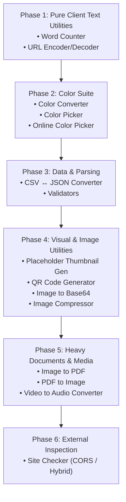

# WebTools — Comprehensive Tools Implementation Plan & Technical Assessment

> **Project Context:** WebTools is a fast, privacy-first, 100% browser-based suite of developer and designer utilities built with **Next.js 16 (App Router)**, **React 19**, **Tailwind CSS v4**, and **TypeScript**. The application is configured with `output: "export"` (pure client-side static build), meaning no server runtime or server-side API routes exist by default.

---

## 1. Executive Summary & Inventory

WebTools defines **19 tools** in [`src/content/home.ts`](file:///home/hasibur/Code/hasiburdev/webtools/src/content/home.ts) and has corresponding custom SVG icons in [`src/components/icons/`](file:///home/hasibur/Code/hasiburdev/webtools/src/components/icons/).

### Current Implementation Status
* **Progress:** 6 of 19 tools completed (31.6%)
* **Implemented (6):** Password Generator, Slugify, Image Resizer, Formatters, Word Counter, Color Picker
* **Remaining (13):** Image Compressor, CSV ↔ JSON Converter, Color Converter, Placeholder Thumbnail Generator, QR Code Generator, Image to PDF, PDF to Image, Video to Audio Converter, Site Checker, URL Encoder/Decoder, Online Color Picker, Image to Base64 Converter, Validators

| # | Tool Name | Route | Status | Complexity | Key Technologies |
|---|---|---|---|---|---|
| 1 | **Password Generator** | `/password-generator` | ✅ Implemented | Low | Web Crypto API (`crypto.getRandomValues`) |
| 2 | **Slugify** | `/slugify` | ✅ Implemented | Low | Regex & Unicode normalization |
| 3 | **Image Resizer** | `/image-resizer` | ✅ Implemented | Medium | HTML5 Canvas, Drag-and-drop |
| 4 | **Formatters** | `/formatters` | ✅ Implemented | Medium | Prettier, smol-toml, yaml, sql-formatter, xml-formatter |
| 5 | **Image Compressor** | `/image-compressor` | ⏳ Pending | Medium | Canvas / `browser-image-compression` |
| 6 | **CSV to JSON & JSON to CSV** | `/csv-json-converter` | ⏳ Pending | Low | `papaparse` / custom RFC 4180 parser |
| 7 | **Color Converter** | `/color-converter` | ⏳ Pending | Low | `colord` / color math |
| 8 | **Placeholder Thumbnail Generator** | `/placeholder-thumbnail-generator` | ⏳ Pending | Low | HTML5 Canvas / SVG rendering |
| 9 | **QR Code Generator** | `/qr-code-generator` | ⏳ Pending | Low | `qrcode` / Canvas / SVG |
| 10 | **Image to PDF** | `/image-to-pdf` | ⏳ Pending | Medium | `pdf-lib` or `jspdf` |
| 11 | **PDF to Image** | `/pdf-to-image` | ⏳ Pending | ⚠️ Medium-High | `pdfjs-dist` (Web Worker setup) |
| 12 | **Video to Audio Converter** | `/video-to-audio-converter` | ⏳ Pending | 🔴 **High (Difficult)** | Web Audio API / `lamejs` or `@ffmpeg/ffmpeg` |
| 13 | **Site Checker** | `/site-checker` | ⏳ Pending | 🔴 **High (Difficult)** | Browser CORS constraint / Proxy / Direct Input |
| 14 | **URL Encoder / Decoder** | `/url-encoder-decoder` | ⏳ Pending | Low | `encodeURIComponent` / `URLSearchParams` |
| 15 | **Online Color Picker** | `/online-color-picker` | ⏳ Pending | ⚠️ Medium | `EyeDropper` API (Chromium only) + Canvas fallback |
| 16 | **Image to Base64 Converter** | `/image-to-base64-converter` | ⏳ Pending | Low | `FileReader` / Data URLs |
| 17 | **Word Counter** | `/word-counter` | ✅ Implemented | Low | Native `Intl.Segmenter` & regex, real-time analytics, case transformations |
| 18 | **Color Picker** | `/color-picker` | ✅ Implemented | Low | Pure TS color math, 2D Sat/Val canvas, harmonies, tints/shades, WCAG 2.1 |
| 19 | **Validators** | `/validators` | ⏳ Pending | ⚠️ Medium | Parsers for JSON, YAML, TOML, Markdown, etc. |

---

## 2. Technical Feasibility & Difficult Tools Deep Dive

Because WebTools runs **strictly in the browser with zero server components** (`output: "export"`), certain utilities encounter browser sandbox, CORS, bundle size, or cross-browser compatibility hurdles.

### 🔴 High Difficulty: Tool #13 — Site Checker (Sitemap, robots.txt, RSS, OG tags, SEO tags)

#### The Problem:
* **Browser CORS Policy:** A browser cannot directly execute `fetch("https://example.com/robots.txt")` or `fetch("https://example.com/sitemap.xml")` because 99% of external websites do not include the `Access-Control-Allow-Origin: *` response header.
* Because the site is exported statically (`output: "export"`), there are no Next.js backend API routes to proxy requests.

#### Recommended Architecture & Solution:
1. **Hybrid Execution Model (Best UX):**
   * **Mode A: Direct Input / Paste & Analyze:** Users can paste raw HTML source code, XML sitemaps, or `robots.txt` text directly, or upload files for instant offline validation and OG tag previews.
   * **Mode B: URL Fetching via Optional CORS Proxy:**
     * Provide a default public CORS proxy (e.g., `https://api.allorigins.win/raw?url=` or CodeTabs).
     * Provide an option in the UI for users to specify their own proxy URL (e.g., Cloudflare Worker).
     * Clearly notify users about the CORS mechanism and privacy implications.
2. **Parser Modules:**
   * **OG / Meta Tag Inspector:** Parse HTML with native `DOMParser`, extract `<title>`, `<meta name="description">`, Open Graph (`og:*`), Twitter cards (`twitter:*`), canonical links, and viewport tags. Render live preview cards for Google SERP, Twitter/X, Facebook, and LinkedIn.
   * **Sitemap Parser:** XML parser for `<urlset>` and `<sitemapindex>` with URL counting, lastmod verification, and broken URL warnings.
   * **Robots.txt Parser:** Inspect User-agent directives, Disallow/Allow paths, sitemap declarations, and host rules.

---

### 🔴 High Difficulty: Tool #12 — Video to Audio Converter

#### The Problem:
* Audio extraction from video containers (`.mp4`, `.mkv`, `.avi`, `.mov`, `.webm`) without server transcoding requires heavy client-side processing.

#### Approaches Evaluated:

| Approach | Pros | Cons | Verdict |
|---|---|---|---|
| **Option A: Web Audio API (`AudioContext.decodeAudioData`)** | Zero heavy bundle download, ultra-fast, native browser speed | Only supports audio/video codecs decoded natively by the browser (AAC in MP4, Opus/Vorbis in WebM). MKV/AVI will fail. | **Recommended for Phase 1** (Lightweight & clean) |
| **Option B: FFmpeg.wasm (`@ffmpeg/ffmpeg`)** | Supports virtually all video/audio formats and bitrate conversions | Massive WebAssembly binary (~25–30 MB), high memory consumption, and multi-threading requires `SharedArrayBuffer` with COOP (`Cross-Origin-Opener-Policy: same-origin`) and COEP (`Cross-Origin-Embedder-Policy: require-corp`) headers. | **Alternative for Advanced Users** (Lazy loaded on demand) |

#### Recommended Implementation:
1. Start with the **Web Audio API + `lamejs` / WAV encoder**:
   * Load the video file into an `AudioContext` or HTML5 `<video>` element.
   * Decode the audio buffer into PCM.
   * Encode to `.wav` (native in ~20 lines of code) or `.mp3` via `lamejs` (~150 KB).
   * Supports standard MP4, WebM, MOV.
2. Provide informative error messaging if an unsupported codec is uploaded.

---

### ⚠️ Medium-High Difficulty: Tool #11 — PDF to Image

#### The Problem:
* Rendering PDF pages into images requires `pdfjs-dist` (Mozilla PDF.js).
* Configuring the PDF.js web worker in Next.js 16 with static exports often causes bundler headaches (worker script paths, Turbopack bundling, CMAP font packages).
* Memory management: Converting a 100-page PDF at high DPI (e.g., 2x or 3x for crisp output) can consume multiple gigabytes of memory and crash the browser tab.

#### Recommended Implementation:
* Use `pdfjs-dist` loaded dynamically with an explicit CDN or local worker path (`/pdf.worker.min.mjs` placed in `/public`).
* Paginated/virtualized rendering: Only render visible pages to canvas, and export images sequentially or batch-download via `jszip`.
* Provide resolution options (1x, 1.5x, 2x scale) and output formats (PNG, JPEG, WebP).

---

### ⚠️ Medium Difficulty: Tool #15 — Online Color Picker (Screen EyeDropper)

#### The Problem:
* The native `window.EyeDropper` API is only supported in Chromium-based browsers (Chrome, Edge, Opera, Brave). It is **not supported** in Firefox or Safari.

#### Recommended Implementation:
* **Progressive Enhancement:**
  * If `window.EyeDropper` is present: Display a prominent "Pick Color from Screen" button that launches the native eyedropper loupe anywhere on the screen.
  * If not supported (Firefox/Safari): Show a friendly badge explaining browser support, and provide an interactive image dropzone where users can drop any screenshot or image to pick pixels via an interactive magnifying canvas loupe.

---

### ⚠️ Medium Difficulty: Tool #19 — Validators (Multi-Language)

#### The Problem:
* The tool specification covers: **JSON, YAML, Markdown, TOML, JS, TS, Go, HTML, and CSS**.
* Most languages have standard JavaScript parsers. However, **Go** does not have a native web runtime without compiling the Go compiler to WebAssembly or using a third-party Go parser.

#### Recommended Implementation:
* **JSON:** Native `JSON.parse` with custom position-to-line/column mapping (or `jsonlint`).
* **YAML:** `yaml` package (already in `package.json`).
* **TOML:** `smol-toml` package (already in `package.json`).
* **HTML:** `htmlhint` or DOMParser error detection.
* **CSS:** `csstree` or lightweight CSS AST parser.
* **JavaScript / TypeScript:** `@babel/parser` or TypeScript's `createSourceFile` parser for AST syntax validation.
* **Markdown:** `remark` / `markdownlint`.
* **Go:** Use a lightweight JavaScript Go parser (e.g., `go-parser` or tree-sitter wasm for Go syntax validation), or validate basic syntax structure.

---

## 3. Detailed Specifications for Remaining Tools

### Group A: Quick Wins & Pure Text Utilities

#### 1. Word Counter (`/word-counter`)
* **Module:** `src/modules/word-counter/`
* **Features:**
  * Real-time metrics: Words, Characters (with spaces), Characters (without spaces), Sentences, Paragraphs, Lines.
  * Reading time estimate (~225 wpm) and Speaking time estimate (~140 wpm).
  * Keyword density table (top 10 most frequent words, excluding common stop words).
  * Case conversions (UPPERCASE, lowercase, Title Case, Sentence case).
* **Dependencies:** None (Pure TypeScript using `Intl.Segmenter` and RegExp).

#### 2. URL Encoder / Decoder (`/url-encoder-decoder`)
* **Module:** `src/modules/url-encoder-decoder/`
* **Features:**
  * Dual-mode: Encode and Decode.
  * Options: Standard (`encodeURIComponent`), Full URL (`encodeURI`), Base64 URL mode.
  * Live Query Parameter Breakdown: Parses query strings into an interactive editable table of key-value pairs.
* **Dependencies:** None (Native JS `encodeURIComponent`, `URL`, `URLSearchParams`).

---

### Group B: Color & Design Utilities

#### 3. Color Converter (`/color-converter`)
* **Module:** `src/modules/color-converter/`
* **Features:**
  * Real-time bidirectional conversion between:
    * **HEX / HEXA**
    * **RGB / RGBA**
    * **HSL / HSLA**
    * **HSV / HSB**
    * **CMYK**
    * **CSS color names**
  * One-click copy for each format with CSS snippets (`rgba(...)`, `hsl(...)`).
  * Contrast ratio against black & white with WCAG AA / AAA compliance badges.
* **Recommended Library:** `colord` (Ultra-lightweight ~1.7 KB, zero dependencies).

#### 4. Color Picker (`/color-picker`)
* **Module:** `src/modules/color-picker/`
* **Features:**
  * Interactive 2D gradient canvas (Saturation / Brightness) + Hue slider + Alpha slider.
  * Shade & Tint palette generator (5 lighter shades, 5 darker shades).
  * Color harmony suggestions: Complementary, Analogous, Triadic, Tetradic.
  * Palette history saved in `localStorage`.
* **Dependencies:** `colord`.

#### 5. Online Color Picker (`/online-color-picker`)
* **Module:** `src/modules/online-color-picker/`
* **Features:**
  * Native Screen EyeDropper (`window.EyeDropper`) with one-click sampling.
  * Image Loupe Fallback: Upload/paste an image, hover with a 5x/10x magnifying glass to inspect and sample exact pixel colors.
  * Color history palette with hex/rgb copy shortcuts.

---

### Group C: Image & Visual Generation

#### 6. Placeholder Thumbnail Generator (`/placeholder-thumbnail-generator`)
* **Module:** `src/modules/placeholder-thumbnail-generator/`
* **Features:**
  * Custom dimensions (Width × Height) with popular presets:
    * Social: YouTube Thumbnail (1280×720), Instagram Post (1080×1080), Open Graph (1200×630), Twitter Header (1500×500).
    * Screen: 1920×1080, 1366×768, 800×600.
  * Customizable background color, text color, label text, font family, and font size.
  * Pattern overlays: Solid, Subtle Grid, Diagonal Stripes, Dots.
  * Download as PNG, WebP, or SVG, and copy direct Data URL or SVG markup.
* **Dependencies:** Native HTML5 Canvas & SVG.

#### 7. QR Code Generator (`/qr-code-generator`)
* **Module:** `src/modules/qr-code-generator/`
* **Features:**
  * Input types: URL, Plain Text, WiFi Network (SSID/Password/Security), vCard (Contact details), Email, SMS.
  * Customization: Foreground color, background color, error correction level (L, M, Q, H), margin/padding.
  * Optional center logo overlay.
  * Download formats: PNG, SVG, or copy to clipboard.
* **Recommended Library:** `qrcode` or `qr-code-styling`.

#### 8. Image to Base64 Converter (`/image-to-base64-converter`)
* **Module:** `src/modules/image-to-base64-converter/`
* **Features:**
  * Bidirectional: Image to Base64 AND Base64 to Image preview.
  * Output formats: Raw Base64 string, Data URI (`data:image/png;base64,...`), HTML `` tag snippet, CSS `background-image` snippet.
  * File size comparison (Original binary size vs. Base64 payload size).
* **Dependencies:** Native `FileReader` and Canvas.

#### 9. Image Compressor (`/image-compressor`)
* **Module:** `src/modules/image-compressor/`
* **Features:**
  * Multi-format support: JPEG, WebP, PNG.
  * Quality slider (0% to 100%) with instant visual preview.
  * Split-screen Before / After comparison slider.
  * Live file size calculation and savings percentage (e.g. "-64%").
  * Batch compression for multiple uploaded images with ZIP download.
* **Recommended Library:** `browser-image-compression` or Canvas-based compressor.

---

### Group D: Data & Parsing

#### 10. CSV to JSON & JSON to CSV (`/csv-json-converter`)
* **Module:** `src/modules/csv-json-converter/`
* **Features:**
  * Tabbed interface: CSV ➔ JSON and JSON ➔ CSV.
  * CSV Options: Delimiter auto-detection (comma, semicolon, tab, pipe), header row toggle, trim whitespace, parse numbers/booleans.
  * JSON Options: Formatted output (2/4 spaces) or minified, handle nested objects (flattening/unflattening).
  * Live interactive data table preview with pagination.
  * File upload (`.csv`, `.json`) and one-click file download.
* **Recommended Library:** `papaparse` (Fastest, handles edge cases, quotes, and multi-line fields cleanly).

#### 11. Validators (`/validators`)
* **Module:** `src/modules/validators/`
* **Features:**
  * Language selector: JSON, YAML, TOML, Markdown, HTML, CSS, JavaScript, TypeScript, Go.
  * Instant syntax validation with line & column error highlights.
  * Detailed diagnostic message box (e.g., "Unexpected token '}' at Line 14, Col 5").
  * Format & Auto-fix button (integrating with the existing formatters engine).
* **Dependencies:** Reuse existing `smol-toml`, `yaml`, plus lightweight parsers.

---

### Group E: Document & Media Conversion

#### 12. Image to PDF (`/image-to-pdf`)
* **Module:** `src/modules/image-to-pdf/`
* **Features:**
  * Multi-image upload with drag-and-drop reordering.
  * Page settings: Page size (A4, Letter, Auto/Fit to Image), orientation (Portrait, Landscape), margins (None, Small, Large).
  * Image quality adjustment to control output PDF file size.
  * Client-side PDF generation and instant download.
* **Recommended Library:** `pdf-lib` (pure JS, fast, zero canvas requirement).

#### 13. PDF to Image (`/pdf-to-image`)
* **Module:** `src/modules/pdf-to-image/`
* **Features:**
  * PDF page thumbnail preview grid.
  * Extract specific page or all pages as PNG, JPEG, or WebP.
  * Quality/Scale settings: 1x (standard), 2x (retina/print).
  * Single page download or batch export as `.zip`.
* **Recommended Library:** `pdfjs-dist` + `jszip`.

#### 14. Video to Audio Converter (`/video-to-audio-converter`)
* **Module:** `src/modules/video-to-audio-converter/`
* **Features:**
  * Drag-and-drop video upload (MP4, WebM, MOV).
  * Video playback preview with audio waveform visualizer.
  * Output formats: MP3 (via `lamejs`) or WAV (lossless PCM).
  * Bitrate selection: 128 kbps, 192 kbps, 320 kbps.
  * Trimming controls (extract only from start time to end time).
* **Recommended Library:** Web Audio API + `lamejs`.

---

## 4. Phase-by-Phase Implementation Roadmap

To maintain velocity and high code quality, implementation should proceed in **6 structured phases**:



### Phase 1: High-Velocity Text Utilities (Days 1–2)
* Tools: **Word Counter**, **URL Encoder/Decoder**
* Dependencies: Zero new packages.
* Effort: Very low, immediate high-value additions.

### Phase 2: Color Suite (Days 3–4)
* Tools: **Color Converter**, **Color Picker**, **Online Color Picker**
* Dependencies: `colord` (~1.7 KB).
* Unified core: Share color conversion algorithms across all three tools.

### Phase 3: Data & Validation (Days 5–7)
* Tools: **CSV to JSON & JSON to CSV**, **Validators**
* Dependencies: `papaparse`, reuse `yaml` & `smol-toml`.
* Leverage existing Monaco / Textarea editor components from the Formatters tool.

### Phase 4: Graphics & Image Utilities (Days 8–10)
* Tools: **Placeholder Thumbnail Generator**, **QR Code Generator**, **Image to Base64**, **Image Compressor**
* Dependencies: `qrcode`, `browser-image-compression`.
* Canvas-centric processing with instant download triggers.

### Phase 5: Heavy Documents & Media (Days 11–14)
* Tools: **Image to PDF**, **PDF to Image**, **Video to Audio Converter**
* Dependencies: `pdf-lib`, `pdfjs-dist`, `jszip`, `lamejs`.
* Requires careful worker configuration, memory management, and chunking.

### Phase 6: External Site & SEO Inspector (Days 15–16)
* Tools: **Site Checker (Sitemap, robots.txt, RSS, OG tags)**
* Strategy: Implement the dual-mode architecture (Direct Input + Configurable CORS Proxy).

---

## 5. Architectural Standards & Developer Guide

When implementing any tool, adhere strictly to the established patterns in the codebase:

1. **Folder Layout per Tool:**
   ```
   src/
     app/
       <tool-slug>/
         page.tsx          # Page component with SEO metadata and layout
     modules/
       <tool-slug>/
         <tool-slug>.tsx   # Main Client Component ("use client")
         utils.ts          # Pure helper functions
         types.ts          # Domain TypeScript interfaces
         index.ts          # Barrel export
   ```

2. **SEO Metadata (`src/content/seo.ts`):**
   * Every new page must have an entry in `pageSeo.<toolName>`.
   * Include title, description, keywords, canonical URL, OpenGraph, and Twitter tags.

3. **Homepage Catalog (`src/content/home.ts`):**
   * Change `href: "/"` to the proper route `href: "/<tool-slug>"`.
   * Remove `disabled: true`.
   * Verify that the icon corresponds to the registered SVG icon in `src/components/icons/index.ts`.

4. **100% Privacy & Offline Capability:**
   * Never send user inputs, images, or files to any remote server.
   * All conversions, formatting, and operations must execute locally in the client browser.
